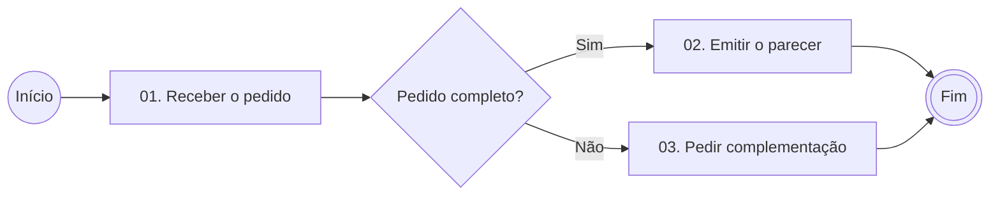

# Instruções para gerar material educacional para o Conteudista

Este documento é lido por uma IA (e por pessoas) antes de produzir **dois arquivos Markdown** que o [Conteudista](https://github.com/anacgovbr/conteudista) converte em apostila e em apresentação. Todas as sintaxes abaixo foram conferidas no código do gerador (`tools/conteudo/markdown.py`) e no editor (`web/editor.js`). O que não está aqui **não é convertido**.

Regras de acessibilidade e linguagem simples, que valem para slides, notas de narração e apostila:
https://raw.githubusercontent.com/anacgovbr/conteudista/main/docs/REGRAS_ACESSIBILIDADE_LINGUAGEM_SIMPLES.md

> **Se você, IA, não conseguir abrir esse endereço, avise e peça que a pessoa cole o conteúdo do documento antes de gerar o material. Não diga que o leu se não teve acesso.**

## 1. Finalidade e entradas

Produzir um material educacional completo a partir de:

- **tema**, **público-alvo** e **objetivos de aprendizagem** informados pela pessoa;
- **arquivos, textos e links de referência** que ela fornecer.

Como usar as fontes:

- Use **apenas** o que foi fornecido. Não invente normas, números, prazos, nomes, siglas ou links.
- Quando faltar informação, escreva `[A confirmar]` no lugar do dado.
- Não inclua dados pessoais nem informações restritas que não estejam nas fontes.
- Use somente imagens que a pessoa enviou, citadas pelo nome do arquivo.

## 2. Planejamento pedagógico

Antes de escrever, defina em silêncio:

1. o que a pessoa deve saber fazer ao final (os objetivos, um por seção);
2. a ordem das ideias, do mais simples ao mais complexo;
3. onde ficam os exercícios e os pontos de verificação;
4. quais conceitos merecem um slide próprio.

## 3. O que entregar: exatamente dois arquivos

| Arquivo | Conteúdo |
|---|---|
| `Apresentacao_NOME.md` | Os slides, **com a narração nas notas de cada slide**. |
| `Apostila_NOME.md` | A apostila complementar, mais aprofundada que os slides. |

**Não crie um terceiro arquivo de narração.** A narração vive dentro de cada slide, em `<!-- notas: … -->` ou `<!-- narracao: … -->` (seção 7).

Formas de entrega:

- **Dois blocos de código `markdown`**, cada um aberto e fechado com **quatro** crases, para preservar os blocos `mermaid` de dentro. Escreva antes de cada bloco o nome do arquivo.
- **Ou um ZIP** sem subpastas com os dois `.md` e, se houver imagens, a pasta `imagens/`. UTF-8 sem BOM. Se você não puder criar arquivos, use os dois blocos.

## 4. Blocos aceitos nos dois arquivos

| Elemento | Como escrever | Observação |
|---|---|---|
| Título | `# `, `## ` até `###### ` | Use em ordem: `#`, `##`, `###`. Não pule níveis. |
| Parágrafo | Linhas seguidas | Uma linha em branco separa parágrafos. |
| Negrito e itálico | `**texto**` e `*texto*` | Para destacar, prefira negrito a maiúsculas. |
| Código em linha | `` `texto` `` | |
| Link | `[texto que diz o destino](https://endereço)` | Só `http`, `https`, `mailto`, relativo ou `#`. Outros esquemas viram texto. |
| Lista | `- item` ou `1. item` | Itens aninhados com dois espaços por nível, até quatro níveis. |
| Checklist | `- [ ] pendente` e `- [x] feito` | |
| Tabela | `\| A \| B \|` com a linha `\|---\|---\|` | A primeira linha é o cabeçalho. |
| Legenda de tabela | Linha `Tabela: nome da tabela` logo antes | Vira a legenda e o nome acessível. |
| Imagem | ``, sozinha na linha | Em ZIP: `imagens/arquivo.png`. |
| Imagem decorativa | `<!-- linguagem-acessivel: decorativa -->` na linha anterior | A imagem sai sem texto alternativo. |
| Caixa | `> [!info] texto`, `> [!tip] texto`, `> [!warning] texto` | O rótulo **Informação:**, **Dica:** ou **Atenção:** aparece sozinho. Não o repita. |
| Citação | `> texto` | |
| Código | Cerca de três crases, com a linguagem | |
| Fluxo | Cerca de três crases com `mermaid` | Seção 6. |

HTML, texto riscado, notas de rodapé e fórmulas **não** são convertidos.

## 5. A apostila complementar

A apostila **aprofunda** os slides. Não copie os slides: explique, dê exemplos e contexto, e inclua exercícios.

- Primeira linha: `# Título da apostila`. Há um único `#`.
- Seções `## 1. Título` e subseções `### 1.1 Título`.
- Comece por **Como usar este material**, com uma tabela “Se você quer | Vá para”.
- Exercícios: seção `## N. Exercícios`, com `### Exercício 1 — Título` e o enunciado.
- Gabarito: seção `## N+1. Gabarito`. **A palavra “Gabarito” no título `##` é obrigatória**: o HTML esconde essa seção até a pessoa pedir para mostrá-la, e o DOCX começa nela uma página nova.
- Última seção: `## N. Referências`, com tabela “Referência | Link”, só com as fontes fornecidas.
- Os `---` soltos entre blocos da apostila são ignorados (não dividem nada).

Exemplo de apostila validado pelos testes: [exemplo de apostila](exemplos/apostila-exemplo.md).

## 6. Fluxos (Mermaid)

Use um bloco `mermaid` que começa com `flowchart LR`. O HTML desenha o fluxo e acrescenta a **tabela do fluxo** (“De”, “Condição”, “Para”). DOCX, PPTX e EPUB trazem só a tabela. Sempre explique o fluxo também em texto.

Convenção de nomes: `T00` início, `T01`… tarefas, `D01`… decisões, `T99` fim. Formas: `T00((Início))`, `T01[01. Texto curto]`, `D01{Pergunta?}`, `T99(((Fim)))`. Ligações: `T01 --> D01` e `D01 -->|Sim| T02`. Não use parênteses, aspas nem dois-pontos nos textos dos nós.

````markdown

````

## 7. A apresentação

### 7.1 Cabeçalho

O arquivo começa assim. Só `title:` é lido. A linha `theme:` é acrescentada pelo Conteudista.

````markdown
---
title: Título da apresentação
---
````

### 7.2 Diretivas (comentários HTML, uma por linha, dentro do slide)

| Diretiva | Efeito |
|---|---|
| `<!-- class: title -->` | Capa (primeiro slide) ou encerramento (último). |
| `<!-- class: highlight -->` | Slide de destaque. |
| `<!-- layout: slug -->` | Modelo de slide (seção 7.4). Nome desconhecido é ignorado. |
| `<!-- notas: texto -->` | Notas do apresentador; também são a narração. |
| `<!-- narracao: texto -->` | Texto falado **no lugar** da nota. |
| `<!-- narracao: nao -->` | Slide sem áudio. Também valem `não`, `no`, `off`, `0` e `-`. |
| `<!-- linguagem-acessivel: decorativa -->` | Marca a imagem seguinte como decorativa. |

### 7.3 Catálogo de formas de dividir e organizar slides

Há três tipos de mecanismo. Misturá-los é um erro comum: **só a sintaxe do primeiro tipo cria slides novos.**

**A. Sintaxe suportada que divide** (testada no parser, `split_slides`):

| Mecanismo | Sintaxe | Quando usar | Limitações | Exemplo |
|---|---|---|---|---|
| Separador | Uma linha com `---` | Sempre que começar um novo assunto | Veja abaixo | A1 |
| Variantes aceitas | `---` com espaços no fim da linha; fim de linha do Windows (CRLF); sem linha em branco ao redor | Texto vindo de editores diferentes | — | A2 |
| Trecho vazio | Dois `---` seguidos | Nunca é necessário | Não gera slide vazio: o trecho é ignorado | A3 |

Limitações do separador (todas verificadas):

- só **três** hifens valem. `----`, `***` e `___` **não** dividem;
- `---` **dentro de um bloco de código também divide**. Não escreva `---` em código nos slides;
- um título `#` **não** cria slide; dois `#` no mesmo trecho continuam um slide só.

**B. Organização visual dentro de um slide** (não divide; muda a disposição):

| Mecanismo | Sintaxe | Quando usar | Limitações | Exemplo |
|---|---|---|---|---|
| Modelo de slide | `<!-- layout: slug -->` | Comparar, listar em cards, mostrar etapas, indicadores | 25 modelos (seção 7.4); nome inválido é ignorado | B1 |
| Capa, encerramento e destaque | `<!-- class: title -->` e `<!-- class: highlight -->` | Abrir, fechar ou chamar atenção | Só `title` e `highlight` têm tratamento definido; outro valor é aceito, mas não é documentado | B2 |
| Fluxo | Bloco `mermaid` | Processo com decisões | Um fluxo por slide; explique em texto | — |

**C. Estratégia pedagógica** (não é sintaxe; você decide como cortar):

| Estratégia | Como aplicar |
|---|---|
| Um assunto por slide | Cada conceito, etapa ou funcionalidade tem o seu slide, na ordem da apostila. |
| Lista grande vira dois slides | Mais de 5 marcadores: divida em dois slides com títulos que se completam. |
| Pergunta e resposta | Um slide faz a pergunta; o seguinte responde. |
| Síntese | Um slide curto fecha cada bloco de assunto. |
| Comparação | Use um modelo de comparação (`antes-depois`, `pros-contras`, `colunas-2`) em vez de dois slides. |

Recomendações do projeto (não são regras do validador): título de até 45 caracteres e **um** elemento principal por slide: até 5 marcadores curtos, uma tabela de até 5 linhas, um fluxo ou uma imagem.

Exemplos desta seção (cada um é aceito pelo parser real; os testes conferem o número de slides):

<!-- exemplo-slides: 2 -->
````markdown
# Primeiro assunto

Texto.

---

# Segundo assunto

Texto.
````

<!-- exemplo-slides: 2 -->
````markdown
# Com espaços e linhas coladas

Texto.
---   
# Também divide
````

<!-- exemplo-slides: 2 -->
````markdown
# Um

Texto.

---


---

# Dois

Trecho vazio ignorado.
````

<!-- exemplo-slides: 1 -->
````markdown
<!-- layout: colunas-2 -->

# Um slide, duas colunas

| Antes | Depois |
|---|---|
| Papel | Sistema |
````

<!-- exemplo-slides: 1 -->
````markdown
<!-- class: highlight -->

# Destaque

> [!warning] O prazo termina na sexta-feira.
````

**Exemplos que não funcionam como se espera** (também testados, para mostrar que as regras não foram relaxadas):

<!-- exemplo-invalido: slides=1 -->
````markdown
# Um

Texto.

----

# Dois

Quatro hifens não dividem: continua um slide só.
````

<!-- exemplo-invalido: slides=1 -->
````markdown
# Um

Texto.

# Dois

Dois títulos no mesmo trecho não criam slide novo.
````

<!-- exemplo-invalido: slides=2 -->
````markdown
# Um

Texto.

---

Slide sem título: o validador aponta o item e2 (para corrigir).
````

<!-- exemplo-invalido: slides=2 -->
````markdown
# Um

```text
codigo
---
mais codigo
```
````

### 7.4 Modelos de slide (`layout`)

São 25 modelos, com estes nomes exatos. Os blocos continuam sendo os de sempre; o modelo só muda a disposição.

| Modelo (`slug`) | O que colocar no slide |
|---|---|
| `branco` | Conteúdo livre. |
| `titulo-conteudo` | `#` título e texto de apoio. |
| `somente-titulo` | Só o `#` título. |
| `imagem-direita` | `#` título, uma imagem e um texto. Imagem na direita (1/3). |
| `imagem-esquerda` | Igual, com a imagem na esquerda (1/3). |
| `meio-meio` | Imagem e texto em 50% cada. |
| `imagem-destaque` | Texto curto (1/3) e imagem grande (2/3). |
| `colunas-2` | Uma tabela de 2 colunas. Cada coluna vira um painel. |
| `colunas-3` | Uma tabela de 3 colunas. |
| `pros-contras` | Tabela `\| Prós \| Contras \|`. |
| `antes-depois` | Tabela `\| Antes \| Depois \|`. |
| `cards-4` | Lista com 4 itens `- **Título** — texto`. |
| `cards-6` | Lista com 6 itens, em 3×2. |
| `cards-8` | Lista com 8 itens. |
| `matriz-2x2` | Tabela 2×2 com cabeçalhos de linha e de coluna. |
| `plano-cartesiano` | Tabela com `Eixo Y / Eixo X` no canto e quatro quadrantes. |
| `swot` | Tabela Interno/Externo × Positivo/Negativo. |
| `priorizacao` | Tabela impacto × esforço. |
| `etapas-3` | Lista numerada com 3 itens. |
| `etapas-5` | Lista numerada com 5 itens. |
| `linha-tempo` | Lista numerada `1. **2024** — marco`. |
| `fluxo-horizontal` | Bloco `mermaid` com `flowchart LR`. |
| `indicadores-2` | Tabela de 2 colunas: rótulo e valor. |
| `indicadores-4` | Tabela de 4 colunas. |
| `dashboard` | Tabela `Métrica \| Valor \| Tendência \| Situação`. |

No PPTX, cards, etapas, linha do tempo e colunas viram formas nativas. No DOCX e no EPUB o conteúdo segue em ordem vertical.

### 7.5 Exemplo completo, com narração em cada slide

<!-- exemplo-validado: apresentacao -->
````markdown
---
title: Pedido de certificação
---

<!-- class: title -->

# Pedido de certificação

## Do envio à decisão

<!-- notas: Esta apresentação mostra as etapas do pedido. Cada slide trata de uma etapa. -->

---

# Etapas do pedido

1. Envie o pedido
2. A área técnica analisa
3. A coordenação decide

<!-- notas: O pedido tem três etapas. Primeiro, o requerente envia os documentos. Depois, a área técnica faz a análise. Por fim, a coordenação decide. -->

---

<!-- layout: antes-depois -->

# Prazo de resposta

Tabela: Prazo de resposta, antes e depois

| Antes | Depois |
|---|---|
| Resposta em trinta dias | Resposta em dez dias |

> [!tip] O prazo conta a partir do envio completo.

<!-- notas: A tabela compara os dois prazos. Antes, a resposta levava trinta dias. Agora leva dez dias. A contagem começa quando o pedido chega completo. -->

---

# Documentos do pedido

Tabela: Documentos exigidos e sua finalidade

| Documento | Para quê |
|---|---|
| Formulário | Identifica o requerente |

<!-- narracao: nao -->
````

Outro exemplo, mais longo: [exemplo de apresentação](exemplos/apresentacao-exemplo.md).

## 8. Notas de narração

As notas viram áudio. Para cada slide, o Conteudista lê `<!-- notas: … -->` ou, se existir, `<!-- narracao: … -->` (função `notas_para_narracao` do gerador).

Regras do gerador:

- um slide só entra na narração se tiver conteúdo além dos comentários;
- `narracao:` substitui a nota; `narracao: nao` deixa o slide sem som;
- slide sem nota e sem `narracao:` fica sem áudio;
- as notas ficam **no próprio slide**. A ordem do áudio é a ordem dos slides.

Como escrever uma boa nota:

- **Fale com a pessoa.** Texto corrido, natural, em tom técnico e direto. Não leia o slide palavra por palavra; **complemente** o que está na tela.
- **Descreva oralmente a informação visual relevante.** Se o slide tem tabela, gráfico, fluxo ou imagem, diga o que ela mostra e o que a pessoa deve notar, sem instruções técnicas como “veja a tabela”. Exemplo para o slide “Prazo de resposta”: “A tabela compara os dois prazos. Antes, a resposta levava trinta dias. Agora leva dez dias.”
- **Frases de até 25 palavras** (validador n1). Prefira até 20.
- Sem símbolos, sem Markdown, sem endereços e sem parênteses.
- Siglas que não se leem por extenso devem ser escritas como se fala.
- Não escreva “este slide”. Tamanho sugerido: de 60 a 100 palavras por slide.

## 9. Checklist antes de entregar

- [ ] Entreguei **dois** arquivos Markdown e nenhum terceiro de narração.
- [ ] A apresentação começa com o cabeçalho `title:` e cada slide tem um `#` título.
- [ ] Os `---` estão sozinhos na linha e nenhum está dentro de bloco de código.
- [ ] Cada slide que precisa de áudio tem `<!-- notas: … -->` com frases de até 25 palavras.
- [ ] A apostila aprofunda os slides, não os repete.
- [ ] Tabelas têm cabeçalho; links dizem o destino; imagens têm descrição.
- [ ] Nada foi inventado; as lacunas estão marcadas com `[A confirmar]`.
- [ ] Revisei o documento de regras de acessibilidade e linguagem simples.

> **Aviso para a IA:** não afirme ter executado os validadores do Conteudista (o botão **Acessibilidade**, a conferência de código ou os testes) se você não os executou. Diga apenas que seguiu as regras e peça que a pessoa confira o botão **Acessibilidade** depois de importar.
