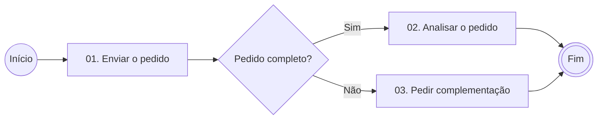

# Pedido de certificação: guia de estudo

Apostila complementar da apresentação.

> [!info] **Objetivo:** ao final, você será capaz de enviar um pedido de certificação completo.

## 1. Como usar este material

Tabela: Onde encontrar cada assunto

| Se você quer | Vá para |
|---|---|
| Saber o que enviar | Seção 2 |
| Entender o prazo | Seção 3 |
| Praticar | Seção 4 |

## 2. O que enviar

O pedido precisa de três documentos. Sem eles, a análise não começa.

### 2.1 Documentos do pedido

- Formulário preenchido
- Comprovante de pagamento
- Descrição técnica do produto
  - Desenho ou foto
  - Lista de materiais

1. Preencha o formulário.
2. Anexe o comprovante.
3. Envie a descrição técnica.

O pedido segue para análise quando está completo. Se faltar documento, a área técnica pede a complementação.

## 3. Prazo de resposta

A resposta leva dez dias. A contagem começa quando o pedido chega completo.

> [!warning] Pedido incompleto não conta prazo.

## 4. Exercícios

### Exercício 1 — Conferir o pedido

Liste os três documentos do pedido.

## 5. Gabarito

### Gabarito 1

Formulário, comprovante de pagamento e descrição técnica.

## 6. Referências

Tabela: Fontes consultadas

| Referência | Link |
|---|---|
| Portal da Agência Nacional de Aviação Civil (ANAC) | [Portal da ANAC](https://www.gov.br/anac) |