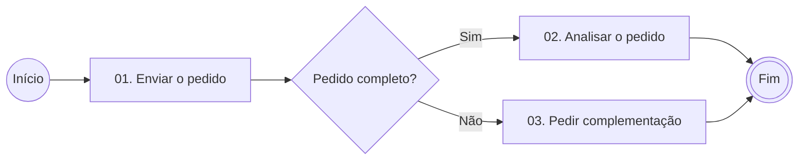

<!-- class: title -->

# Pedido de certificação

## Do envio à decisão

<!-- notas: Esta apresentação mostra como funciona um pedido de certificação. Cada slide trata de uma etapa. Ao final, você saberá enviar o pedido sem erros. -->

---

# O que você vai aprender

- Enviar o pedido completo
- Acompanhar a análise
- Entender o prazo de resposta

<!-- notas: Você vai aprender três coisas. Primeiro, enviar o pedido com todos os documentos. Depois, acompanhar a análise. Por fim, entender o prazo de resposta. -->

---

# Etapas do pedido

O pedido segue para análise quando está completo. Se faltar algum documento, a área técnica pede a complementação.

<!-- notas: O fluxo começa com o envio do pedido. Se o pedido estiver completo, ele segue para a análise. Se faltar documento, a área técnica pede a complementação. Nos dois casos, o fluxo termina. -->

---

<!-- layout: antes-depois -->

# Prazo de resposta

Tabela: Prazo de resposta, antes e depois

| Antes | Depois |
|---|---|
| Resposta em trinta dias | Resposta em dez dias |

> [!tip] O prazo conta a partir do envio completo.

<!-- notas: A tabela compara os dois prazos. Antes, a resposta levava trinta dias. Agora leva dez dias. A contagem começa quando o pedido chega completo. -->

---

# Quatro etapas em cartões

<!-- layout: cards-4 -->

- **Enviar** — o requerente envia os documentos
- **Conferir** — a área técnica confere o pedido
- **Analisar** — a equipe analisa o conteúdo
- **Decidir** — a coordenação publica a decisão

<!-- notas: Cada cartão mostra uma etapa. Primeiro, o requerente envia os documentos. Depois, a área técnica confere o pedido. Em seguida, a equipe analisa o conteúdo. Por fim, a coordenação publica a decisão. -->

---

# Para saber mais

Leia o [guia do pedido de certificação](https://www.gov.br/anac) no portal da Agência Nacional de Aviação Civil (ANAC).

<!-- narracao: Para saber mais, leia o guia do pedido de certificação no portal da Agência Nacional de Aviação Civil (ANAC). -->

---

<!-- class: title -->

# Obrigado

## Dúvidas? Procure a área técnica.

<!-- narracao: nao -->