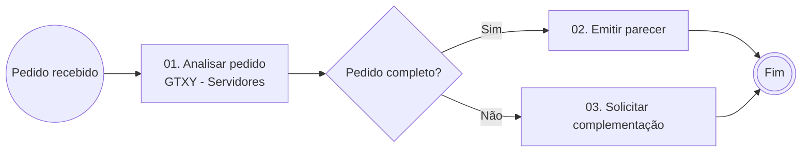

# Curso de Exemplo — Guia Prático

**Treinamento organizacional para novos servidores**

Unidade Responsável · Órgão · Versão 1.0

> [!info] **Objetivo:** demonstrar o formato. Substitua este texto pelo guia gerado pelo agente "Gerador de Cursos ANAC".

## 1. Como usar este material

| Se você quer… | Vá para |
|---|---|
| Ver o passo a passo | Seção 2 |
| Praticar | Seções 4 e 5 |

## 2. Passo a passo

1. Abra o processo no sistema.
2. Preencha o formulário.
3. Envie ao gestor.

## 3. Checklists

### Checklist A — Antes de enviar

- [ ] Conferi a versão vigente.
- [ ] O gestor está ciente.

## 4. Exercícios

### Exercício 1 — Classifique

Qual rota usar para um ajuste pontual?

## 5. Gabarito

### Gabarito 1

Use o link de **Comentários** do documento.

## 6. Referências

| Referência | Link |
|---|---|
| Lei de Acesso à Informação | [planalto.gov.br — Lei 12.527](https://www.planalto.gov.br/ccivil_03/_ato2011-2014/2011/lei/l12527.htm) |
