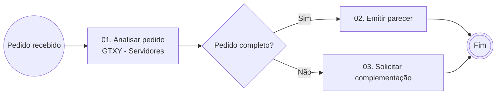

# Conteúdo de Exemplo — Apostila Prática

**Treinamento organizacional para novos servidores**

Unidade Responsável · Órgão · Versão 1.0

> [!info] **Objetivo:** demonstrar o formato. Substitua este texto pela apostila gerada pelo agente "Gerador de Cursos ANAC".

## 1. Como usar este material

| Se você quer… | Vá para |
|---|---|
| Ver o passo a passo | Seção 2 |
| Praticar | Seções 4 e 5 |

## 2. Passo a passo

1. Abra o processo no sistema.
2. Preencha o formulário.
3. Envie ao gestor.

### 2.1 Imagem de exemplo

![Figura 1 — Exemplo de imagem embutida](data:image/png;base64,iVBORw0KGgoAAAANSUhEUgAAAeAAAADICAIAAAC/PqUtAAALBElEQVR4nO3ae1SUZR7A8WcuQGC2Wrqm6wVTa/ACiZdA1FVbSUMTMQVzS8sbsq4tqChRHo5JAimGt7CLJ1sNhDBdCUtrlY4kKl4CTJQKL7llsJsmym2G2T/eHDncAjs2v/T7+Wt4Z/y9D+/gl+e8g+6Hy+UKACCP3t4LAADUj0ADgFAEGgCEItAAIBSBBgChCDQACEWgAUAoAg0AQhFoABDK2PjTXceE/zbrAIA7U1F6XENPsYMGAKEINAAIRaABQKhfuAddUyM3SgAATdfEj/fYQQOAUAQaAIQi0AAgFIEGAKEINAAIRaABQCgCDQBCEWgAEIpAA4BQBBoAhCLQACAUgQYAoQg0AAhFoAFAKAINAEIRaAAQikADgFAEGgCEItAAIBSBBgChCDQACEWgAUAoAg0AQhFoABCKQAOAUAQaAIQi0AAgFIEGAKEINAAIRaABQCgCDQBCEWgAEIpAA4BQBBoAhCLQACAUgQYAoQg0AAhFoAFAKAINAEIRaAAQikADgFAEGgCEItAAIBSBBgChCDQACEWgAUAoAg0AQhFoABCKQAOAUAQaAIQi0AAgFIEGAKEINAAIRaABQCgCDQBCEWgAEIpAA4BQBBoAhCLQACAUgQYAoQg0AAhFoAFAKAINAEIRaAAQikADgFAEGgCEItAAIBSBBgChCDQACEWgAUAoAg0AQhFoABCKQAOAUAQaAIQi0AAgFIEGAKEItGj/PnzSbLbYexW3itls2ZdTYO9VAHLZM9DugUvseHb5Cyi5VPqvzONGo0Ep5RYQGbQ4cXLEhonh63MLzyulTAEvTI7YUHdU0kcHx4WumbBg3bNRG78vuXxLV9i4aqs1asOOgAVrJy16/dz3/6v51N6cAlPAC0ajYfu+YyWXSn/lIoHbFTtoubbuPjS8v0l77OBgSI4JTlo+e1lIwIvrP1BKOToYzRZLdt7XNf/J/mOFHx/IT3s1JG3F3x7p/UB4Qqod1n3dlozsu52dtq2YO91/yCtvp9uOXy2rWJv8qdFgUEoN629K2XPYfmsERDPaewFKKeUeuGSUd++D+d/MmjAs50TRkZNnp471me4/5PS5i5Fr034qLZvkO3C6/5CSS6WLV79/ufRax3b3ZuYUHE2KulxaFpW4vfjHK5VmS+T0MR4PdmpkmnYu25Au7e/TjtQ7pN7jwdHvBjzaz9erV8SatIG9uo4Y6Nass7sHLgl67JFjBWd1Ot3KsMBO7e7VTlT845XwhNSrZRUtnJ3inp/YtnVL7XjmkVMrwwJrXauHXO//9vpuNHSK76ote7bGdLM9+8a2zAXPPKZtup/28z5acNZSXW3Q6xv6Nhu/VppXNn5oW3NZRVXNd2TTzqyUPYd1Ot2iaaPde3SqNX/HvqMrw4KUUiMGuJ35T4ltYOw7Gc+NGxyxNk0p1fehzkkfHQyZOPxX/QABtykRO+iKSvNTo72Slge/tP6DaU8MTlo++41tmUqpd3dmhU8dvTV2jvZl9NvpY4Z6pMaFjPbpc7W8Uim1fOOHU8f6bI6e9dqCyRFr3m98msY2xNe7d0WluaEh9R6Pmj0u4b09uYXnvyu5NH6EZ3PPXllldu/RMTUu5KlRjyx7c2fNJT0x9OGU2DlPDH245k6z6EJxh7atal2rrC++6vlAB+3xII/uSqkDuTc20YXnLppc22uPWzg7vfHiVK3ON3et6q651juyOvmTlNg5CQsnf7D3aN3531wo2XPwRNDixLkxm/0Ge2gDc748c/G/P/kN+fnLjn9sXXShuJGfDeBOJmIHrdfp+vToaNDrHYyGPj066nW6sopKpVTEc347Pzv+6aGTpdfKlVLZeV/HzntSKfXoADeDXqeUyjx6yrY1u1Zeqe0WG5qmaeKQeo/f3+YP40d4znx50/uvhtzE2XVK95h3b6XU44Pdo2uEODv367jnJyql/Ia4x76TYTtutlTb8lpVZQlanGhVqqXLXTHzJtpeEzplZPzm3d7uc67/k58/UXxr+2efZH9ZfOnKp4kLtSM3ca3qrnnfm4tqviPD+5vCViY/7TcoPizIe1p0rflVZsuf2rZOjgnelZW3aHXqluhZlVXm6LfTEyOfsc03GPRVt++noMCvJCLQDg4GrUROjka9Tmc7HrL8n6N9+kwb67M544BSyvY/udpqtVqVUspiqd60dIaTo7Haas05UaQNaWiapolDGjp+razSoNdfK6u8ibPr9Tq9/ucjjg43rry1gcvSqqWLdt9DXb8HXfc1Xn26GfT6z7/4SvvStUObgjPfuffoNMN/6KSRAwY+/bLtlTdxrequudY7siI08FD+Nxt37N+Reazu/Dat7vb17qWU8vXuFblum1JqV1be1bKK5+Pe065kWHzy0mD/Vi1dGrgAwJ1OxC2OhuQVfus32KOiylxZZVZK9TN12ZN9Qin18YF8q7Iqpfr3dP34QL5Sal9OwfrUvU2Z2fQhdY8XXSjef7xwY9SzSxK3W63W5p7dbKnW/qosY3+ut/uNG8fe7t0ysvKUUhlZeV41jvc1dT519vtfHBs6ZeSqLbu1x0+N8orfvFv7y7x30z+3/bJp5Nts1pprviNXrpYHLk70NHWJnx+0N6eg7vxBHt0P5RcppQ7lF/Xs2l4pNW5Y393r5yfHBCfHBLs4O8aHBZ0+d7GvqXMTFwPcaUTsoBvyV79BExauc+va/p67nSurzC/OHDs/fuum9M89TV1cnByVUi/NHBuxJm3LrmyjQb/87082ZaZtSD+3Lto2tqEhdY9Hrtu2aNrjJtf2D3Zul7L7cHPP7uRo3JWVtyEt854Wzto9DdcObdan7o14zm9RQup7u7Jd7nLUjmvG/bnvZ0dPe5q6ND52YO8HHB2M2u8w/+F9vzp/cdTcVe3uu8d/uKfBcCPQN3Gt6q65Q9vWtnfEydH46AC38fPXVlut84L+MtKrZ635YVN8w1enrk76xGDQR8+dUO/8zCOn/Id5NnExwJ1G98Pl8kae7jom3Pa4KD3u1q+nMQtWbZ0xfqjJtX1u4fllb6WnxM6x73qayz1wSe7WpU1/vdVqDV2ZvOIfk7S/yrj9mM2WhQmpq+YH2XshwG+tiWkVvYOuZepYnyWvb7/L0aHKbFkWMt7ey7nldDrdawsm23sVt5DRaKDOQCN+T4Hu073j727XXFOzts8AIPpDQgC4kxFoABCKQAOAUAQaAIQi0AAgFIEGAKEINAAIRaABQCgCDQBCEWgAEIpAA4BQBBoAhCLQACAUgQYAoQg0AAhFoAFAKAINAEIRaAAQikADgFAEGgCEItAAIBSBBgChCDQACEWgAUAoAg0AQhFoABCKQAOAUAQaAIQi0AAgFIEGAKEINAAIRaABQCgCDQBCEWgAEIpAA4BQBBoAhCLQACAUgQYAoQg0AAhFoAFAKAINAEIRaAAQikADgFAEGgCEItAAIBSBBgChCDQACEWgAUAoAg0AQhFoABCKQAOAUAQaAIQi0AAgFIEGAKEINAAIRaABQCgCDQBCEWgAEIpAA4BQBBoAhCLQACAUgQYAoQg0AAhFoAFAKAINAEIRaAAQikADgFAEGgCEItAAIBSBBgChCDQACEWgAUAoAg0AQhFoABCKQAOAUAQaAIQi0AAgFIEGAKEINAAIRaABQCgCDQBCEWgAEIpAA4BQBBoAhDI2/aVdx4TfunUAAGphBw0AQhFoABCKQAOAULofLpfbew0AgHqwgwYAoQg0AAhFoAFAKAINAEIRaAAQikADgFAEGgCEItAAINT/AZADbjPund1LAAAAAElFTkSuQmCC)

Ícone em linha:  indica um destaque.

## 3. Checklists

### Checklist A — Antes de enviar

- [ ] Conferi a versão vigente.
- [ ] O gestor está ciente.

## 4. Exercícios

### Exercício 1 — Classifique

Qual rota usar para um ajuste pontual?

## 5. Gabarito

### Gabarito 1

Use o link de **Comentários** do documento.

## 6. Referências

| Referência | Link |
|---|---|
| Lei de Acesso à Informação | [planalto.gov.br — Lei 12.527](https://www.planalto.gov.br/ccivil_03/_ato2011-2014/2011/lei/l12527.htm) |
